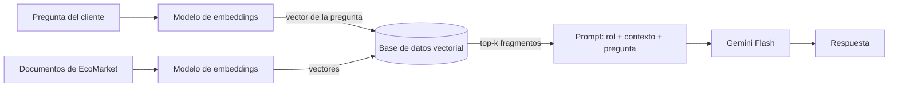

# Fase 1: Selección de Componentes clave del sistema RAG

En el Taller 1 propusimos una arquitectura **LLM general (Gemini Flash) + RAG + consulta
estructurada**. Sin embargo, la implementación nunca usó una base de datos vectorial, solo insertaba
en el prompt los archivos completos de pedidos y de política de devoluciones.

Esto no es óptimo para una operación con más clientes y que demanda más transacciones. Por esa
razón, ahora en este taller el asistente de EcoMarket debe ser capaz de recuperar solo los fragmentos relevantes de 
una base de conocimientos, la cual se basará en dos componentes: un modelo de embeddings y una base de datos vectorial. 

## Modelo de embeddings

### Elección: `gemini-embedding-001` (Google, propietario)

### Criterios de elección

| Criterio | Por qué importa Gemini-Embedding en EcoMarket |
|---|---|
| **Español** | Todas las consultas y documentos están en español, incluso con jerga de la zona ya sea latinoamericana o española. Un modelo entrenado en inglés perdería precisión al comparar la consulta con el documento. |
| **Precisión de recuperación** | Si el fragmento correcto no se recupera, el LLM no puede responder bien o alucinará. El embedding es el "techo" de calidad del RAG. |
| **Costo** | Se generan embeddings una vez por documento (indexación) y una vez **por cada consulta**. Con miles de consultas diarias, el costo por consulta pesa más que el de indexar. |
| **Coherencia con el stack** | Ya usamos Gemini como LLM (Taller 1): una sola API key, un solo proveedor, una sola factura. |

### Justificación

1. **Español:** al ser multilingüe de forma nativa, el modelo interpreta mejor las preguntas de los
   clientes relacionadas con los productos de EcoMarket. Por ejemplo, ante la pregunta *"¿Puedo
   devolver un cepillo de dientes de bambú?"*, el modelo es capaz de relacionarla con la regla de
   higiene personal de la política de devoluciones, aunque la pregunta nunca mencione esas palabras.
2. **Costo:** el volumen de documentos de EcoMarket (políticas, catálogo y FAQs) es pequeño: indexarlo
   todo cuesta muy poco, centavos. El costo recurrente es el embedding de cada consulta, que es corto (pocas
   decenas de tokens). El nivel gratuito cubre el prototipo del taller.
3. **Operación:** no hay que administrar modelos ni GPUs. Para un e-commerce en crecimiento es
   preferible pagar por uso a mantener infraestructura de inferencia.
4. **Coherencia:** el mismo SDK y la misma API key que el LLM simplifican el código y la gestión de
   secretos.

**Riesgos y mitigaciones:**

| Riesgo | Mitigación |
|---|---|
| Dependencia del proveedor (*vendor lock-in*) | El modelo se configura en `GEMINI_EMBEDDING_MODEL`; LangChain abstrae la interfaz. Cambiarlo solo exige re-indexar. |
| Los documentos se envían a una API externa | Solo se indexan documentos **públicos o internos no sensibles** (políticas, catálogo, FAQs). Los datos personales de pedidos se consultan por API/SQL, no se vectorizan (ver Fase 2). |
| Límites de cuota (nivel gratuito) | Indexar por lotes; en producción, usar el nivel de pago. |

## Base de datos vectorial

### Elección: **ChromaDB** para el prototipo, con un camino de migración a **PostgreSQL + pgvector** o **Pinecone (serverless)** en producción

### Comparación

| Criterio | **ChromaDB** | **PostgreSQL + pgvector** | **Pinecone** |
|---|---|---|---|
| **Modelo** | Código abierto; embebida (archivo local) o en modo servidor | Código abierto; extensión que convierte a PostgreSQL en base vectorial (tipo `vector`, operadores de distancia e índices HNSW/IVFFlat) | SaaS administrado (serverless) |
| **Facilidad de uso** | Muy alta: `pip install`, cero configuración, se persiste en una carpeta | Media: hay que levantar un servidor PostgreSQL (o Docker), instalar la extensión y crear la tabla; las consultas son SQL normal | Alta: solo API key, pero requiere crear el índice y una cuenta |
| **Costo** | Gratis (solo el disco/servidor propio) | Gratis (licencia); si EcoMarket ya tiene PostgreSQL, el costo adicional es mínimo | Nivel gratuito limitado; después se paga por almacenamiento y lecturas |
| **Escalabilidad** | Buena hasta millones de vectores en un nodo; la alta disponibilidad requiere más trabajo | Buena hasta millones de vectores; hereda la replicación y los respaldos de PostgreSQL | Muy alta, se escala sola |
| **Funcionalidades** | Filtros por metadatos, persistencia local | Búsqueda vectorial **combinada con SQL**: filtros (`WHERE`), *joins* con tablas de pedidos o productos, transacciones | Filtros por metadatos, *namespaces* (multi-tenant), búsqueda híbrida |
| **Operación** | Mínima (embebida) | Media; nula si ya existe un PostgreSQL administrado (Cloud SQL, RDS, Supabase) | Ninguna |
| **Integración LangChain** | `langchain-chroma` (la que usa el repo de referencia) | `langchain-postgres` (`PGVector`) | `langchain-pinecone` |
| **Desventajas** | No es un servicio distribuido; el modo embebido no sirve para varios servidores web a la vez | Requiere un servidor corriendo; ajustar índices para volúmenes muy grandes | Datos en un tercero; costo creciente; *vendor lock-in* |

### Justificación para EcoMarket

- **Volumen real pequeño:** la base de conocimiento (políticas, catálogo de unos cientos o miles de
  productos y FAQs) son **miles de fragmentos, no millones**. Chroma lo maneja con latencias de
  milisegundos en un solo nodo.
- **Costo cero para el prototipo** y ninguna cuenta adicional que crear.
- **Facilidad:** ya está integrada en el código de referencia que se mostró en la sesión. 
- **Filtros por metadatos:** aunque en este taller no se usan, a futuro permitiría restringir la
  búsqueda, por ejemplo solo a la política de devoluciones o a una categoría de productos.

## Resumen

| Componente | Elección | Razón principal |
|---|---|---|
| LLM | Gemini Flash (`GEMINI_MODEL`) | Continuidad con el Taller 1; bajo costo y latencia |
| Embeddings | `gemini-embedding-001` | Multilingüe de alta precisión, sin infraestructura y mismo proveedor |
| Base vectorial | ChromaDB (persistente local) | Gratis, simple y suficiente para el volumen de EcoMarket; migrable |
| Framework | LangChain | Usado en el repositorio de referencia |
