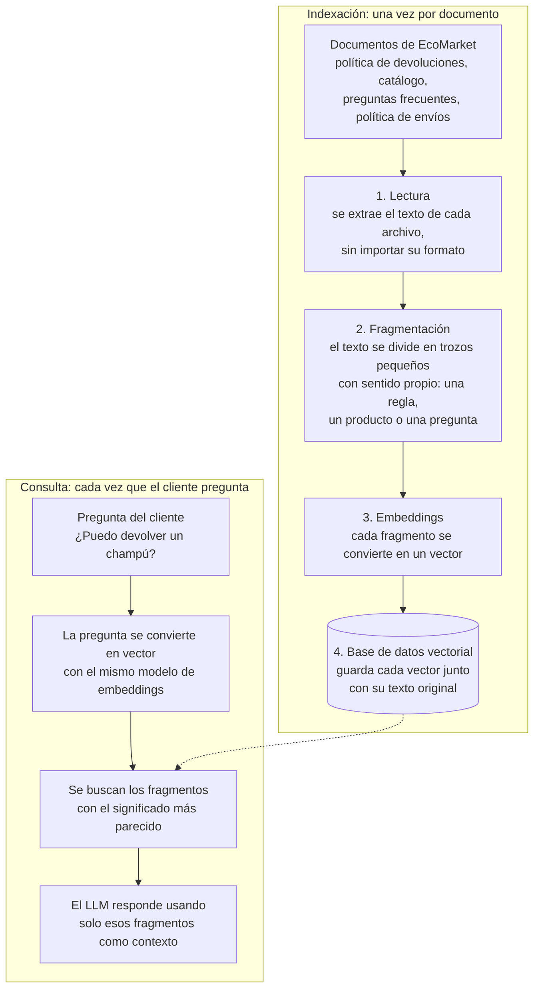

# Fase 2: Creación de la base de conocimiento de documentos

## 1. Identificación de documentos

1. **Política de devoluciones y garantías** (PDF, basada en la del Taller 1): Contiene los
   plazos, las condiciones, los productos que no se pueden devolver, las excepciones por daño y el
   proceso de devolución paso a paso.
2. **Catálogo de productos** (CSV):  Una fila por producto
   con su nombre, categoría, descripción, materiales, precio, si es devolvible, garantía y
   disponibilidad.
3. **Preguntas frecuentes** (JSON):  Pares de pregunta y respuesta sobre envíos, medios de pago, 
    cuentas y sostenibilidad.
4. **Política de envíos** (Markdown): Cobertura, tiempos de entrega por ciudad, costos y transportadoras.

## 2. Segmentación (chunking)

### 2.1 Estrategias posibles

| Estrategia | Funcionamiento | Ventajas | Desventajas |
|---|---|---|---|
| **Tamaño fijo** (`CharacterTextSplitter`, la del repo de referencia: 1000 caracteres, sin solapamiento) | Corta cada N caracteres o tokens | Simple y predecible | Corta reglas, frases o filas por la mitad. Sin solapamiento, se pierde el contexto entre fragmentos. |
| **Por párrafos o separador** | Corta en `\n\n` | Respeta las unidades naturales del texto | Los párrafos tienen tamaños muy desiguales: algunos son enormes y otros casi vacíos |
| **Recursiva** (`RecursiveCharacterTextSplitter`) | Intenta cortar por `\n\n`; si el fragmento sigue siendo grande, por `\n`, luego por `. `, luego por espacio | Respeta la estructura cuando puede y garantiza un tamaño máximo | Requiere ajustar el tamaño y el solapamiento |
| **Por estructura del documento** | Una fila del CSV, un par de la FAQ, una sección numerada o un encabezado de Markdown por fragmento | Cada fragmento es una **unidad de significado** completa y autocontenida | Requiere un *loader* o *splitter* específico por formato |
| **Semántica** | Corta donde cambia el tema, según la similitud entre oraciones | Fragmentos temáticamente coherentes | Más lenta y costosa, porque calcula embeddings al segmentar; poco necesaria con documentos cortos y bien estructurados |

### 2.2 Estrategia propuesta: **segmentación recursiva**

Se propone usar un solo `RecursiveCharacterTextSplitter` para todos los documentos, con fragmentos
de unos 800 caracteres y un solapamiento de unos 100. Es el cambio más pequeño posible sobre el
repositorio de referencia: reemplaza el `CharacterTextSplitter` por el recursivo, y el resto del
flujo queda igual.

Además, se aprovecha que dos de los documentos ya vienen divididos en unidades naturales:

- **Catálogo (CSV):** `CSVLoader` crea un `Document` por fila, así que cada producto queda en su
  propio fragmento sin hacer nada adicional.
- **Preguntas frecuentes (JSON):** cada par de pregunta y respuesta se carga como un `Document`, así
  que cada pregunta queda con su respuesta.
- **Política de devoluciones (PDF) y política de envíos (Markdown):** son los textos largos. Aquí el
  splitter recursivo intenta cortar primero por párrafos y luego por líneas, de modo que en la
  mayoría de los casos cada regla o sección queda completa.

### 2.3 Justificación

- **Precisión:** la pregunta de un cliente suele referirse a **una** regla o **un** producto. Si el
  fragmento contiene exactamente esa unidad, su embedding queda más cerca de la pregunta que uno de
  1000 caracteres que mezcla tres temas.
- **Riesgo del tamaño fijo, observado en la práctica:** en este repositorio probamos el
  `CharacterTextSplitter` original (1000 caracteres, sin solapamiento) con el archivo
  `politica-devoluciones.txt` del Taller 1. Se generaron 4 fragmentos: uno de 36 caracteres con solo
  el título, uno de 1025 caracteres con las 7 reglas juntas, uno de 18 caracteres con solo "LISTA DE
  PRODUCTOS" y uno de 1314 caracteres con la tabla de productos, ya sin su título. LangChain además
  advirtió `Created a chunk of size 1025, which is longer than the specified 1000`. Es decir, quedan
  fragmentos casi vacíos que no aportan nada al buscar, la tabla queda separada de su título y los
  fragmentos superan el tamaño pedido. Con un documento más largo, un corte fijo también podría
  separar la regla 4 (excepción por daño) de la regla 3 (no devolvibles), y el modelo respondería
  "no se puede devolver" **sin mencionar la excepción**.
- **Solapamiento (~100 caracteres):** si una regla queda partida entre dos fragmentos, el
  solapamiento repite el final del primero al inicio del segundo, y así no se pierde el contexto.
- **Tamaño moderado (~800 caracteres):** los fragmentos muy pequeños pierden contexto ("No" ¿no
  qué?) y los muy grandes diluyen la señal y gastan tokens del LLM.
- **Simplicidad:** se mantiene la estructura del repositorio de referencia y solo se cambia el
  splitter, lo que facilita comparar el comportamiento antes y después del cambio.

## 3. Indexación

La indexación consiste en preparar los documentos de EcoMarket para que después se puedan buscar
por significado y no solo por palabras exactas. Ocurre una sola vez por documento, cuando se carga.
Luego, cada vez que un cliente pregunta, se usa lo que quedó guardado:

### Paso a paso

1. **Carga:** desde la barra lateral de la app se sube el documento. `load_document()` en
   `vector_functions.py` elige el *loader* según la extensión (`PyPDFLoader`, `CSVLoader`,
   `UnstructuredMarkdownLoader`) y lo convierte en objetos `Document`, que tienen el texto y algunos
   metadatos básicos como el nombre del archivo, la página o la fila.
2. **Segmentación:** el `RecursiveCharacterTextSplitter` divide los documentos largos en fragmentos.
3. **Embeddings:** cada fragmento se envía a `gemini-embedding-001`, que devuelve un vector de 3072
   dimensiones.
4. **Almacenamiento:** `create_collection()` guarda los vectores y el texto en ChromaDB, en la
   carpeta `./persist`. Si el chat ya tiene documentos, `add_documents_to_collection()` agrega los
   nuevos a la misma colección.

Cuando el cliente hace una pregunta, esta se convierte en vector con el **mismo** modelo, y
`load_retriever()` devuelve los fragmentos más parecidos que superen el umbral de similitud
(`score_threshold`). Si ninguno lo supera, el asistente debe responder que no tiene la información,
que es lo que pide el taller: "hacerle saber al usuario que no tiene las herramientas para atender su
solicitud".