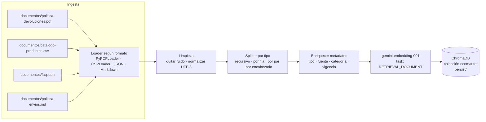

# Fase 2: Creación de la base de conocimiento de documentos

Esta fase define **qué** documentos entran, **cómo** se dividen y **cómo** se indexan.

## 1. Identificación de documentos

| # | Documento | Formato | Contenido | Preguntas que resuelve | Frecuencia de cambio |
|---|---|---|---|---|---|
| 1 | **Política de devoluciones y garantías** | PDF ([`documentos/politica-devoluciones.pdf`](documentos/politica-devoluciones.pdf), basado en el Taller 1) | Plazos, condiciones, productos no devolvibles, excepciones por daño, proceso paso a paso | "¿Puedo devolver X?", "¿cuánto tarda el reembolso?" | Baja (trimestral) |
| 2 | **Catálogo de productos** | CSV ([`documentos/catalogo-productos.csv`](documentos/catalogo-productos.csv)) | Nombre, categoría, descripción, materiales, precio, ¿devolvible?, garantía, disponibilidad | "¿La botella es apta para bebidas calientes?", "¿el champú tiene garantía?" | Alta (semanal) |
| 3 | **Preguntas frecuentes (FAQ)** | JSON ([`documentos/faq.json`](documentos/faq.json)) | Pares pregunta-respuesta sobre envíos, medios de pago, cuentas, sostenibilidad | "¿Hacen envíos a Pasto?", "¿aceptan PSE?" | Media (mensual) |
| 4 | **Políticas de envío** | Markdown ([`documentos/politica-envios.md`](documentos/politica-envios.md)) | Cobertura, tiempos por ciudad, costos, transportadoras | "¿Cuánto se demora a Barranquilla?" | Media |

## 2. Segmentación (chunking)

### 2.1 Estrategias posibles

| Estrategia | Cómo funciona | Ventajas | Desventajas |
|---|---|---|---|
| **Tamaño fijo** (`CharacterTextSplitter`, la del repo de referencia: 1000 caracteres, sin solapamiento) | Corta cada N caracteres o tokens | Simple y predecible | Corta reglas, frases o filas por la mitad. Sin solapamiento, se pierde el contexto entre fragmentos. |
| **Por párrafos o separador** | Corta en `\n\n` | Respeta las unidades naturales del texto | Los párrafos tienen tamaños muy desiguales: algunos son enormes y otros casi vacíos |
| **Recursiva** (`RecursiveCharacterTextSplitter`) | Intenta cortar por `\n\n`; si el fragmento sigue siendo grande, por `\n`, luego por `. `, luego por espacio | Respeta la estructura cuando puede y garantiza un tamaño máximo | Requiere ajustar el tamaño y el solapamiento |
| **Por estructura del documento** | Una fila del CSV, un par de la FAQ, una sección numerada o un encabezado de Markdown por fragmento | Cada fragmento es una **unidad de significado** completa y autocontenida | Requiere un *loader* o *splitter* específico por formato |
| **Semántica** | Corta donde cambia el tema, según la similitud entre oraciones | Fragmentos temáticamente coherentes | Más lenta y costosa, porque calcula embeddings al segmentar; poco necesaria con documentos cortos y bien estructurados |

### 2.2 Estrategia propuesta: **segmentación por tipo de documento**

Se propone una estrategia por cada tipo de documento del RAG: 

| Documento | Estrategia | Unidad de fragmento | Tamaño aprox. | Metadatos |
|---|---|---|---|---|
| Política de devoluciones | **Recursiva** con separadores ajustados a las secciones numeradas | Una regla o sección | 300–800 caracteres, solapamiento de ~100 | `tipo=politica`, `seccion`, `vigencia` |
| Catálogo (CSV) | **Por fila** (`CSVLoader` ya genera un `Document` por fila) | Un producto | Una fila | `tipo=producto`, `categoria`, `devolvible`, `sku` |
| FAQ (JSON) | **Por par** pregunta-respuesta | Una pregunta con su respuesta | Variable (corto) | `tipo=faq`, `tema` |
| Envíos (MD/HTML) | **Por encabezado** (`MarkdownHeaderTextSplitter`) y luego recursiva si la sección es larga | Una sección | 300–800 caracteres | `tipo=envios`, `seccion` |

### 2.3 Justificación

- **Precisión:** la pregunta de un cliente suele referirse a **una** regla o **un** producto. Si el
  fragmento contiene exactamente esa unidad, su embedding queda más cerca de la pregunta que uno de
  1000 caracteres que mezcla tres temas.
- **Riesgo del tamaño fijo, observado en la práctica:** al indexar la política de devoluciones del Taller 1 con el
  `CharacterTextSplitter` original, LangChain advirtió `Created a chunk of size 1025, which is longer
  than the specified 1000`. Además, la tabla de productos y las reglas quedan mezcladas en el mismo
  fragmento. Con tamaño fijo y sin solapamiento, la regla 4 (excepción por daño) podría quedar separada de
  la regla 3 (no devolvibles), y el modelo respondería "no se puede devolver" **sin mencionar la
  excepción**.
- **Solapamiento (~100 caracteres) en la política:** conserva el contexto cuando una regla depende de la
  anterior. No se usa en el CSV ni en la FAQ, porque cada fila o par ya es autocontenido.
- **Tamaño moderado (300–800 caracteres):** los fragmentos muy pequeños pierden contexto ("No" ¿no
  qué?) y los muy grandes diluyen la señal y gastan tokens del LLM. Con `k = 4`, el contexto enviado
  queda por debajo de unos 3.000 caracteres.
- **Metadatos:** permiten filtrar (`tipo=producto`), citar la fuente en la respuesta y re-indexar
  solo un documento cuando cambia.

## 3. Indexación

### Paso a paso

1. **Carga:** un *loader* por formato convierte cada archivo en objetos `Document`
   (`page_content` + `metadata`). En el repositorio, esto lo hace `load_document()` en
   `vector_functions.py`, que se ajustó para leer en UTF-8 y no fallar con tildes en Windows.
2. **Limpieza:** se normaliza el texto y se eliminan encabezados repetidos y ruido de HTML.
3. **Segmentación:** se aplica el *splitter* correspondiente a cada tipo (sección 2.2).
4. **Metadatos:** a cada fragmento se le agregan `tipo`, `fuente`, `categoria` y `vigencia`, además de
   un **ID estable** (por ejemplo, un hash de `fuente + sección`). Así, al re-indexar se
   **actualiza** el fragmento en lugar de duplicarlo.
5. **Embeddings:** cada fragmento se envía a `gemini-embedding-001`, que devuelve un vector de 3072
   dimensiones (verificado en la prueba del repo). Los documentos se vectorizan como
   `RETRIEVAL_DOCUMENT` y las preguntas como `RETRIEVAL_QUERY`. LangChain hace esta distinción
   automáticamente en `embed_documents()` y `embed_query()`. Los envíos se hacen por lotes para
   respetar la cuota de la API.
6. **Carga en Chroma:** `Chroma.from_documents(...)` guarda vectores, texto y metadatos en la
   colección, persistida en `./persist`. En el repositorio, esto lo hace `create_collection()`, y
   `add_documents_to_collection()` permite agregar documentos nuevos.
7. **Consulta (tiempo de ejecución):** la pregunta se vectoriza con el **mismo** modelo y Chroma
   devuelve los `k` fragmentos más cercanos que superen el `score_threshold`
   (`load_retriever()`). Si ninguno lo supera, el asistente debe responder que no tiene la
   información y ofrecer escalar a un agente humano. Esto cumple el requisito del taller de "hacerle
   saber al usuario que no tiene las herramientas para atender su solicitud".

### Mantenimiento del índice

| Evento | Acción |
|---|---|
| Cambia la política | Re-indexar solo los fragmentos con `fuente=politica` (*upsert* por ID estable) |
| Producto nuevo o descontinuado | Agregar o eliminar la fila correspondiente en la colección |
| Cambio de modelo de embeddings | Borrar `persist/` y re-indexar todo |
| Pregunta frecuente sin respuesta | Detectada en los registros (sin contexto recuperado); se agrega a `faq.json` |

## 4. Próximo paso (Fase 3)

Los cuatro documentos de ejemplo ya están en la carpeta [`documentos/`](documentos/). Falta
reemplazar el `CharacterTextSplitter` por la segmentación por tipo, y adaptar el prompt de
`generate_answer_from_context()` con el rol, los delimitadores y el manejo de "no sé" del
`settings-final.toml` del Taller 1.
